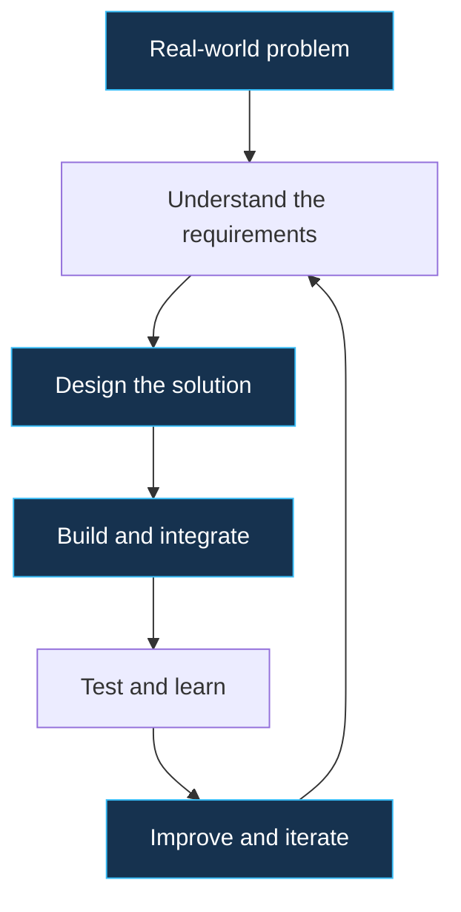

# \
Reuben Idan\

\
   \<strong>Software Engineer · Data Engineer · Founder\</strong> \

\
   \ \

\
   \<a href="[https://www.linkedin.com/in/reuben-idan/](https://www.linkedin.com/in/reuben-idan/)">LinkedIn\</a> ·   \<a href="[https://reuben-idan.vercel.app/](https://reuben-idan.vercel.app/)">Portfolio\</a> ·   \<a href="[https://datahaulinc.com/](https://datahaulinc.com/)">DataHaul Agritech\</a> ·   \<a href="mailto\:idanreuben\@gmail.com">Email\</a> \

---

## About

I'm a software engineering student, developer and entrepreneur in Ghana, interested in building technology that addresses practical problems.

My interests sit at the intersection of software engineering, data and cloud infrastructure. I enjoy understanding how things work, thinking through systems, and turning ideas and requirements into useful software.

I'm currently building [**DataHaul Agritech**](https://datahaulinc.com/), an initiative exploring how technology can improve agricultural commerce, market access and intelligence across Africa.

Beyond writing code, I'm interested in the problems behind the technology: how people use it, the systems that support it, and whether what we build actually makes a difference.

I'm still learning, experimenting and growing as an engineer. I believe good engineering is as much about asking the right questions as it is about finding the right solutions.

## What I'm Working On

### DataHaul Agritech

Building a multi-channel agricultural commerce and intelligence platform connecting farmers, input suppliers and buyers.

The broader ambition is to contribute to the infrastructure supporting more accessible, transparent and climate-smart food systems in Africa.

Areas of exploration include:

- Agricultural marketplaces and digital commerce.
- Data-driven agricultural and market intelligence.
- AI-assisted insights and decision support.
- QR-based traceability and supply-chain visibility.
- Accessible digital services for underserved farming communities.

[Explore DataHaul](https://datahaulinc.com/)

## Areas of Interest

| Area                    | What interests me                                                            |
| ----------------------- | ---------------------------------------------------------------------------- |
| Software Engineering    | Backend development, APIs, application architecture and maintainable systems |
| Data Engineering        | Data pipelines, processing, modelling and analytics                          |
| Cloud Computing         | Cloud infrastructure, deployment and scalable applications                   |
| Artificial Intelligence | Practical AI applications, intelligent systems and decision support          |
| Product Development     | Turning real-world problems into useful, accessible software                 |

## Technology

The tools I work with and continue to develop my skills in:

**Languages**

\

**Frameworks and Development**

\

**Data and Cloud**

\

## How I Think About Building

I find it useful to think of software development as a process that connects problems, people, data and technology.

I value simplicity, curiosity, continuous learning and the discipline to improve on what already exists.

## Education and Professional Development

My academic and professional development spans software engineering, data and business.

- **BSc Software Engineering** — [Frontier Institute of Technology](https://fit.edu.gh/) *(In Progress)*
- **BA Insurance and Economics** — University of Ghana.
- **Generation Ghana** — Web Development Programme; Valedictorian.
- **ALX** — Backend and Frontend Software Engineering Programmes.
- **ExploreAI** — Data Science and Engineering.
- **Amazon Web Services** — AWS Certified Cloud Practitioner.

I continue to invest in learning through technical programmes, independent projects and practical problem-solving.

## GitHub

\

&#x20; \
&#x20; \
\

\

&#x20; \
\

---

## Let's Connect

\

&#x20; I'm always open to meaningful conversations, collaboration and opportunities to learn and build.
\

\

&#x20; Whether it's software engineering, data, cloud technology, agritech or an interesting problem worth solving, I'd be glad to connect.
\

\

&#x20; \<a href="[https://www.linkedin.com/in/reuben-idan/](https://www.linkedin.com/in/reuben-idan/)">
&#x20;   \
&#x20; \</a>
&#x20; \<a href="[https://reuben-idan.vercel.app/](https://reuben-idan.vercel.app/)">
&#x20;   \
&#x20; \</a>
&#x20; \<a href="mailto\:idanreuben\@gmail.com">
&#x20;   \
&#x20; \</a>
\

\

&#x20; \<i>Always learning. Always building. Always asking what can be done better.\</i>
\

